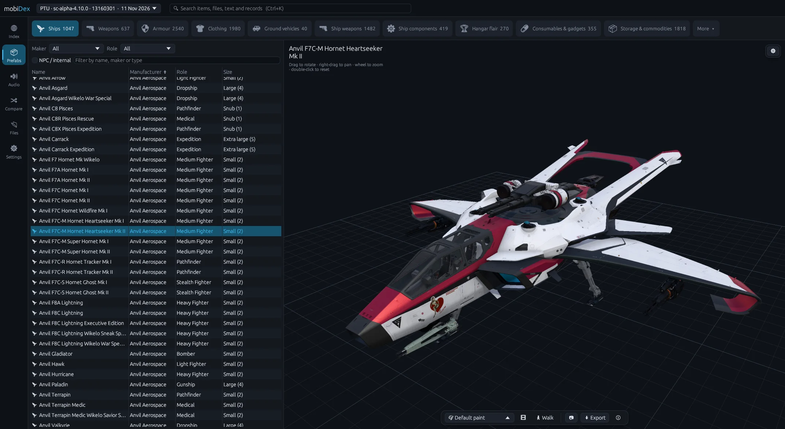

  <picture>
    <source media="(prefers-color-scheme: dark)" srcset="assets/logo-light.png">
    <source media="(prefers-color-scheme: light)" srcset="assets/logo-dark.png">
    
  </picture>

<h1 align="center">mobiDex</h1>

  <b>A Star Citizen <code>Data.p4k</code> explorer — models, game data, audio and patch changes in one app.</b>

  
  

  

---

## What it is

mobiDex opens the game archive that ships with every Star Citizen install (`Data.p4k`) and lets you look inside it. You can view ships, weapons and armour in 3D, browse every file, read the game's data in plain tables, listen to its sound effects, and see what changed between two patches.

It only **reads** your game files. It never changes them, never connects to the game's servers and doesn't need the game to be running.

## Download

1. Go to **[Releases](../../releases/latest)** and download the latest `mobiDex-x.y.z.zip`.
2. Unzip it anywhere and run **`mobiDex.exe`**. There's no installer.
3. On the start screen, pick your `Data.p4k`, usually  
   `C:\Program Files\Roberts Space Industries\StarCitizen\LIVE\Data.p4k`.  
   mobiDex also lists any LIVE / PTU / EPTU installs it finds and the archives you've opened before.

**Needs:** Windows 10 or 11 (64-bit), a graphics card with OpenGL 3.3, and 8 GB of RAM (16 GB or more recommended for big ships with textures).

## Features

### 🚀 Models
- **Ships, ground vehicles, weapons, armour, clothing, ship components, ship weapons, gadgets, hangar flair** and more, with their in-game names, makers, roles and sizes (Snub, Small, Medium, Large, Capital…).
- **Full assemblies:** turrets, guns, landing gear, thrusters and other attached parts, with interiors optional.
- **Textures and materials**, including normal maps, gloss and the layered paints of ships, weapons and suits. Pick the texture size and level of detail to suit your PC.
- **Paints and liveries:** switch a ship's paint on the model.
- **Armour and clothing on the character**, with stances and emotes.
- **Rendering modes:** rendered (PBR), plain shaded, material colours, wireframe, plus ambient occlusion, cavity, grid and background colour.
- **Walk mode** to fly around and inside big ships.
- **Filters:** search, maker, role, type and size. Weapon attachments are grouped, ship weapons are sorted by type (guns, turrets, missile racks, decoy launchers…), and *Hide variants* shows each ship only once.
- **Locations and holoviewer models** under *More*.
- **Export** as **GLB**, **Blender (.blend)**, **STL** (for 3D printing) or the **Original** game files. Exports can open in Blender as soon as they're done.
- **Screenshots** of the 3D view.

### 📇 Index: the game's data, readable
- **Ships & vehicles:** crew, size, cargo (SCU), speeds, weapon mounts, the default loadout, shields, quantum drive, fuel, price and where to buy, and every paint with its icon.
- **Weapons, armour and ship components** with their key stats.
- **Blueprints, missions, contracts, rewards and Wikelo's trades.**
- **All items**, or **any record type** as a table.
- A 3D preview of the selected entry, search and drop-down filters, copy to clipboard and **CSV export**.

### 🔊 Audio
- Browse the game's sounds by **event**, **item** or **sound bank**.
- Waveform player with *play next*, and the sounds used by any item.
- **Export to MP3, OGG or WAV**, one sound or many.

### 🔀 Compare two patches
- Open another build (e.g. LIVE vs PTU) and get a **summary** of new, changed and removed ships, weapons and components.
- **Stat-by-stat changes** for ships, weapons and components, plus changes to records, text and files, with diffs.
- A **changelog** you can export.
- Files are compared by their real content (checksums, falling back to the bytes), so unchanged files aren't reported as changed.

### 📂 Files
- Browse the whole archive like a folder tree, with type, size and date.
- **Preview** models, textures (DDS), XML (including the game's binary CryXML), text and hex.
- **Extract** files and folders, with DDS → PNG and CryXML → XML conversion if you want it.

### 🔎 Everywhere
- **Global search** (Ctrl+K) across items, files, text strings and records.
- **Settings:** start-up behaviour, interface size, viewer defaults, performance options, MP3 quality, and the **Blender** path with a one-click install of the StarBreaker add-on.
- A status bar showing memory, CPU and GPU use, and a log file for bug reports.

## Reporting a problem

Open an [issue](../../issues) and include:
- what you clicked and what happened,
- the game version (shown at the top of the window),
- the log file `mobiDex.log`. Its location is shown in the status bar and under **Settings → Diagnostics**.

## Credits

mobiDex stands on the work of the Star Citizen data-mining community and the Rust ecosystem.

| | |
|---|---|
| **[StarBreaker](https://github.com/diogotr7/StarBreaker)** by **Diogo Trindade** (MIT) | The core of the archive, DataCore, CryXML, DDS, Wwise audio and 3D model readers. mobiDex uses a modified copy. Also the **StarBreaker Blender add-on**, which mobiDex bundles and can install for you. |
| **[Blender](https://www.blender.org)** | Not included. mobiDex can open exports in your own copy. |

Each third-party component remains under its own licence and copyright.

## Legal

**mobiDex is an unofficial, fan-made tool. It is not affiliated with, endorsed, sponsored or approved by Cloud Imperium Games Corporation, Cloud Imperium Rights LLC or Roberts Space Industries Corp.** (together, "CIG").

*Star Citizen®*, *Squadron 42®*, *Roberts Space Industries®* and *Cloud Imperium®* are trademarks of Cloud Imperium Rights LLC. All game content (including models, textures, audio, text and data) is © Cloud Imperium Rights LLC and Cloud Imperium Rights Ltd. mobiDex contains **no game content**. It only reads the files of a copy of Star Citizen that you already have installed.

- **Educational and personal use only.** mobiDex is provided to explore and learn about the game's files.
- **Not for commercial use.** Neither mobiDex nor anything you export with it may be sold or used commercially. Anything you export remains CIG's property, and its use is governed by CIG's [Terms of Service](https://robertsspaceindustries.com/tos) and [End User Licence Agreement](https://robertsspaceindustries.com/eula), and CIG's fan content policy. You are responsible for following them.
- **Don't use it to cheat** or to gain an unfair advantage in the game.
- **No warranty.** mobiDex is provided "as is", without warranty of any kind. The author is not liable for any damage or loss arising from its use.
- **Closed source.** mobiDex's source code is not public. This repository hosts releases and the issue tracker only. You may not decompile, modify or redistribute mobiDex without permission.

---

  <picture>
    
  </picture>

  New to Star Citizen? Enlist with referral code
  <a href="https://www.robertsspaceindustries.com/enlist?referral=STAR-J56P-K3PV"><b>STAR-J56P-K3PV</b></a>
  for bonus in-game credits.

